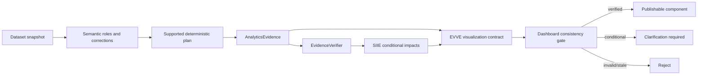

# AURA-BI: Ambiguity-Aware and Evidence-Verified Visual Analytics for Heterogeneous Business Data

**Draft status:** research manuscript draft, not formatted for a selected IEEE venue. Results are limited to repository artifacts identified below. Bracketed citations map to the reference list.

## Abstract

Business-data questions can be numerically well formed while semantically underspecified: for example, “sales” may refer to gross or net sales. AURA-BI is a deterministic Python prototype that profiles tabular data, infers candidate business roles, computes bounded alternative interpretations, binds numerical claims to evidence, and optionally produces conditional chart contracts. This draft describes three additive research components: the Semantic Interpretation Impact Engine (SIIE), which compares aggregate, grouped, ranking, and chart-series consequences of candidate definitions; the Evidence-Verified Visualization Engine (EVVE), which validates chart contracts against deterministic evidence; and a cross-dashboard consistency gate. In a documented retrospective developer-authored policy study, conditional evidence produced complete correct conditional responses for 10/10 ambiguous fixtures, while first-candidate selection produced 10 unsafe unconditional responses among 332 fixtures. These figures are not independent validation. A newer six-case synthetic held-out fixture run is useful only as reproducibility plumbing: it lacks independent authorship, frozen visualization/dashboard labels, a fair completed baseline experiment, and a running LLM baseline. Consequently, this manuscript makes implementation and measurement claims, not novelty, usability, superiority, or state-of-the-art claims.

## Keywords

Business intelligence; semantic ambiguity; data provenance; visual analytics; selective answering; evidence verification.

## 1. Introduction and research gap

Natural-language data interfaces must map words to columns, aggregations, scopes, and charts. A system can therefore return an arithmetically correct value for the wrong business definition. Text-to-SQL research has established ambiguity and unanswerability as important problems [1]–[4]. Natural-language visualization systems also confront ambiguity in attributes, tasks, and visual encodings [5], [6].

The prototype gap addressed here is narrower than general text-to-SQL: for a supported single-table descriptive question, expose the verified observed consequences of admissible business-metric columns, rather than silently selecting one. The new contribution under investigation is not ambiguity detection itself. It is the combination of bounded interpretation-impact comparison, evidence-bound visualization contracts, and cross-dashboard consistency checks. DataTone already provides ambiguity-aware visualization interaction [5]; NL4DV produces analytic visualization specifications [6]. The present implementation has not yet established a material research distinction from those systems through an independent comparative study.

## 2. Related work

AmbiQT showed that one natural-language database question can correspond to multiple plausible SQL queries and evaluated coverage of alternatives [1]. Wang et al. studied ambiguous and unknown text-to-SQL questions [2]. PRACTIQ introduced conversational ambiguous and unanswerable text-to-SQL cases [3]. These works motivate refusal and clarification, but AURA-BI currently operates over a limited deterministic, single-table grammar rather than SQL.

DataTone models an ambiguity space for visualization interaction [5]. NL4DV maps natural-language requests to analytic and visualization specifications [6]. EVVE does not claim to replace these systems; it verifies a compact chart contract against computed evidence. W3C PROV supplies a general provenance model [7], while AURA-BI currently uses application-specific evidence objects rather than a PROV-O mapping. NIST AI RMF identifies validity, reliability, transparency, and explainability as trustworthiness considerations [8]. Selective classification motivates jointly reporting coverage and error rather than treating abstention as success [9].

## 3. Methodology

### 3.1 Formal definitions

Let (D) be an immutable dataset snapshot with identifier (d), (q) a supported question, and (C(q)=\{c_1,\ldots,c_k\}) the detected admissible columns for a business term. For a deterministic plan (p), AURA-BI computes

\[
E_i = \operatorname{Exec}(D,c_i,p), \qquad i\in\{1,\ldots,k\},
\]

where (E_i) records dataset identity, source columns, filters, method, result, definition, and timestamp. An unanswered or invalid candidate remains visible as unsupported; it is not replaced by another candidate.

For candidate pair (c_i,c_j), aggregate sensitivity is

\[
\Delta_{ij}=|A(E_i)-A(E_j)|, \qquad
\delta_{ij}=\begin{cases}\Delta_{ij}/|A(E_i)|,& A(E_i)\ne0\\ \bot,& A(E_i)=0.\end{cases}
\]

SIIE also compares grouped mappings (G_i), rankings (R_i), and normalized positive-total chart shapes (H_i). It emits `VALUE_SENSITIVE` when aggregates differ, `RANKING_SENSITIVE` when tested rankings differ, `VISUALIZATION_SENSITIVE` when tested shapes differ, `STABLE_TESTED_OUTPUT` only when tested outputs agree, and `INCOMPLETE_COMPARISON` for bounded or unavailable comparisons. Agreement is observational and does not establish semantic equivalence.

A numerical claim (z) is verified only if its evidence identifier, dataset, source columns, filters, operation/path, and finite expected value agree with the evidence binding:

\[
V(z,E)=1 \iff z=E[\operatorname{path}(z)] \land \operatorname{metadata}(z)=\operatorname{metadata}(E).
\]

EVVE defines visualization specification (S=(t,d,v,m,g,a,f,\tau,u,\chi,\alpha,Y,e)): chart type, dataset/version, metric definition, dimensions, aggregation, filters, temporal scope, unit, currency, axes, series, and evidence IDs. Verification requires matching identity, definition, filters/scope, units/currency, exact ordered series, finite values, and chart-specific prerequisites.

For dashboard components (x,y) declared directly comparable, the consistency predicate is

\[
K(x,y)=I[d_x=d_y\land v_x=v_y\land m_x=m_y\land a_x=a_y\land f_x=f_y\land \tau_x=\tau_y\land u_x=u_y\land \chi_x=\chi_y].
\]

The predicate is deliberately not evaluated for views without a declared direct-comparison group, avoiding false alarms for legitimate filtered or grouped views.

Selective output is

\[
\operatorname{Publish}(x)=\begin{cases}
\text{publish},&V=1\ \text{and no consistency conflict};\\
\text{require clarification},&\text{definition is conditional};\\
\text{reject},&\text{evidence is invalid, stale, unsupported, or conflicting}.
\end{cases}
\]

### 3.2 Architecture



The existing AURA-BI prototype supplies Flask routes, Pandas-based profiling, schema heuristics, KPI discovery, legacy charts, forecasting, anomaly diagnostics, AutoML, MongoDB persistence, and optional Gemini narration. The research additions are SIIE, EVVE, and dashboard consistency modules. They preserve the existing UI and do not execute LLM-generated code or SQL.

An opt-in `research-dashboard-contract-v1` implementation composes these additions into a server-trusted workflow and permits a PDF/JSON research export only when all included answers and EVVE specifications are verified and the dashboard consistency gate returns `PUBLISH_VERIFIED`. This is an implementation methodology statement, not an evaluated effectiveness claim; legacy Flask charts and reports remain outside this contract.

### 3.3 Algorithms

```text
Algorithm 1: Conditional semantic-impact comparison
Input: D, supported plan p, candidate columns C, confirmed dimensions L
for c in first 32 candidates of C:
    compute sum, mean, valid rows, grouped series, ranks, chart series
    create evidence E_c and verify exact aggregate bindings
for every verified pair (E_i, E_j):
    compare aggregate, groups, ranks, and normalized chart shape
classify tested effects; mark incomplete coverage when needed
return conditional alternatives, impact graph, and no selected definition
```

```text
Algorithm 2: Evidence-verified visualization
Input: evidence E and chart specification S
reject unsupported chart type or missing evidence ID
check dataset/version, definition, aggregation, filters, scope, unit/currency
check exact ordered chart series and finite values
check axes/scales and chart-specific requirements
return VERIFIED, INVALID, AMBIGUOUS, INSUFFICIENT_EVIDENCE, or UNSUPPORTED
```

## 4. Experimental setup

The executed retrospective study contains 332 developer-authored synthetic fixtures, ten seeded datasets, and fixed adversarial cases. A separate Decimal implementation checks arithmetic. It compares post-hoc first-candidate, clarification-only, and conditional-evidence policies while holding parser, detector, computation, and verifier constant. It is not an independent end-to-end baseline comparison.

The newer semantic/visual runner has six developer-authored stress fixtures plus a development-only case. Earlier naming called the six rows “held-out,” but they are no longer described that way: their authorship, schemas, and labels remain under developer control. It records raw rows, status, impact labels, latency, package versions, resource maximum RSS, and split manifest. The optional LLM baseline is not run without both `GEMINI_API_KEY` and `AURA_ENABLE_LLM=true`.

An external-evaluation package loader now requires a human-authored frozen manifest, separate system inputs and labels, per-snapshot SHA-256 checksums, and independent annotation/adjudication records. No such corpus exists in the repository at this draft date; therefore this infrastructure has generated no comparative result.

## 5. Results and discussion

### 5.1 Measured retrospective policy study

| Policy | Resolved answerable cases | Unsafe unconditional answers | Complete correct conditional ambiguous responses |
|---|---:|---:|---:|
| First candidate | 243/243 | 10/332 | 0/10 |
| Clarification only | 243/243 | 0/332 | 0/10 |
| Conditional evidence | 243/243 | 0/332 | 10/10 |

Table values are copied from the measured `docs/validation/research-policy-study.json` protocol artifact. The conditional-completeness metric favors conditional evidence by construction; it is not a neutral utility metric. These findings support only that the observed policies behaved as stated on this retrospective regression suite.

### 5.2 Measured developer stress-fixture run

The measured artifact `/private/tmp/semantic-visual-measured.json` contains six developer stress cases per ablation. The full configuration recorded numerical correctness 1.0, unsafe unconditional-answer rate 0.0, correct-refusal rate 1.0, answerable coverage 1.0, impact precision 0.667, impact recall 1.0, and mean latency 0.00489 s. These values are not publication results: the fixture set is small, correlated, developer-authored, and the precision computation is not a complete independently annotated impact benchmark. Visualization accuracy and dashboard detection accuracy were explicitly recorded as not measured.

The “without ambiguity comparison” configuration recorded answerable coverage 0.0 on this fixture run. This is a negative example: its apparently safe unsafe-answer rate does not establish usefulness. No paired confidence interval or significance test is reported because the cases do not provide independent clusters.

### 5.3 Ablation and baseline status

The repository has executable B0 manual, B1 first-candidate, B2 clarification-only, B3 numeric-only, B4 full, and B5 provider-gated adapters. B0–B4 have not yet produced a frozen, fair, complete comparative trace on independently authored cases. B5 is `NOT RUN`, not assigned synthetic performance. EVVE and dashboard ablations are contract-level modules but do not yet have frozen independent benchmark labels. The new external runner emits `NOT RUN` rather than silently consuming developer fixtures, and its paired-analysis helper refuses fewer than three dataset clusters. Therefore no table of claimed baseline improvements or paper-ready comparative figure is defensible.

## 6. Threats to validity and unresolved evidence

1. All current semantic/visual fixture authorship is developer controlled; “held-out” denotes a code split, not independent data collection.
2. Templates and seeded variants are correlated. Rows are not independent statistical samples.
3. Candidate-definition precision/recall lacks independent annotation.
4. Chart validity and dashboard inconsistency detection have contract tests but no frozen independent gold benchmark.
5. B0/B1/B2 are simplified adapters; B3/B4 share implementation; B5 has not run.
6. The system is limited to supported single-table operations. It does not evaluate joins, arbitrary SQL, unrestricted language, formulas, conversion policy, fiscal calendars, or causal inference.
7. Evidence verification validates bindings to computed evidence; it does not establish business-semantic truth.
8. No user study evaluates whether conditional evidence improves definition selection or comprehension.

## 7. Conclusion

AURA-BI implements an evidence-first prototype for bounded ambiguity-aware business analytics. SIIE exposes candidate-dependent numerical, ranking, and chart consequences; EVVE verifies chart contracts; and dashboard consistency checks enforce declared comparability constraints. The implemented artifacts support reproducibility and safety-oriented engineering claims. They do not yet support claims of independent generalization, user benefit, superiority over published systems, novelty, or conference readiness. A defensible submission requires frozen independently authored data, completed matched baselines, LLM execution or explicit exclusion, independent visualization/dashboard labels, and appropriately clustered paired analysis.

## Pre-submission checklist

- [ ] Select target IEEE conference, obtain its official template and page limit.
- [ ] Freeze code, split manifest, prompts, dependencies, and dataset hashes before new data collection.
- [ ] Obtain at least two independent annotators and adjudication for candidate definitions, answerability, chart validity, and dashboard conflicts.
- [ ] Split by source dataset and question template; keep all development data separate.
- [ ] Run B0–B4 on the same frozen cases and resource budget; retain every raw trace.
- [ ] Run B5 only with declared model/version/prompt/budget/access; otherwise report `NOT RUN`.
- [ ] Add independent visualization and dashboard ground truth.
- [ ] Compute paired differences and cluster bootstrap intervals only after sufficient independent clusters exist.
- [ ] Generate figures/tables only from a frozen measured output and include denominators.
- [ ] Verify reference metadata against publisher records before submission.
- [ ] Remove all novelty, superiority, usability, and causal claims not supported by the final evidence.

## References

[1] A. Bhaskar, T. Tomar, A. Sathe, and S. Sarawagi, “Benchmarking and Improving Text-to-SQL Generation under Ambiguity,” *Proc. EMNLP*, 2023, pp. 7053–7074. https://aclanthology.org/2023.emnlp-main.436/

[2] B. Wang, Y. Gao, Z. Li, and J.-G. Lou, “Know What I Don’t Know: Handling Ambiguous and Unknown Questions for Text-to-SQL,” *Findings of ACL*, 2023, pp. 5701–5714. https://aclanthology.org/2023.findings-acl.352/

[3] M. Dong et al., “PRACTIQ: A Practical Conversational Text-to-SQL Dataset with Ambiguous and Unanswerable Queries,” *Proc. NAACL*, 2025, pp. 255–273. https://aclanthology.org/2025.naacl-long.13/

[4] I. Saparina and M. Lapata, “Disambiguate First, Parse Later: Generating Interpretations for Ambiguity Resolution in Semantic Parsing,” *Findings of ACL*, 2025, pp. 16825–16839. https://aclanthology.org/2025.findings-acl.863/

[5] T. Gao, M. Dontcheva, E. Adar, Z. Liu, and K. Karahalios, “DataTone: Managing Ambiguity in Natural Language Interfaces for Data Visualization,” *Proc. UIST*, 2015. https://www.zcliu.cs.umd.edu/datatone/DataTone-UIST15.pdf

[6] A. Narechania, A. Srinivasan, and J. Stasko, “NL4DV: A Toolkit for Generating Analytic Specifications for Data Visualization from Natural Language Queries,” *IEEE TVCG*, vol. 27, no. 2, pp. 369–379, 2021. https://doi.org/10.1109/TVCG.2020.3030378

[7] W3C, “PROV-Overview: An Overview of the PROV Family of Documents,” 2013. https://www.w3.org/TR/prov-overview/

[8] NIST, “Artificial Intelligence Risk Management Framework (AI RMF 1.0),” NIST AI 100-1, 2023. https://doi.org/10.6028/NIST.AI.100-1

[9] Y. Geifman and R. El-Yaniv, “Selective Classification for Deep Neural Networks,” *Proc. NeurIPS*, 2017. https://papers.neurips.cc/paper_files/paper/2017/hash/4a8423d5e91fda00bb7e46540e2b0cf1-Abstract.html
